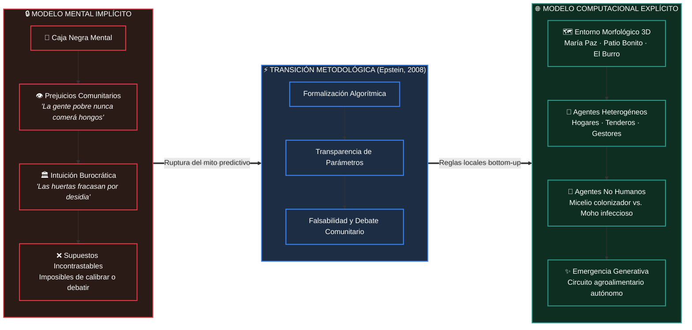

# 🏙️ Kennedy 2030: De los Modelos Mentales Implícitos a la Explicación Generativa

> **Superando el mito de la predicción: hacer transparentes los supuestos del territorio popular**  
> *Diapositiva 1 · Marco Epistemológico y Metodológico de Simulación Urbana Basada en Agentes (ABM)*

---

[](#)
[](https://alejagoguti-cpu.github.io/kennedy-2030-infografia/)
[](#)
[-e76f51?style=for-the-badge)](#)
[](#)

---

## 🧭 Infografía Conceptual: La Transición Metodológica



---

## 📌 Núcleos Teóricos y Evidencia Territorial

| Dimensión | 1. "Usted ya es un modelador" | 2. Explicar no es Predecir | 3. Parámetros del Territorio |
| :--- | :--- | :--- | :--- |
| **Referencia** | Joshua M. Epstein (2008) | Razón 1 de Epstein: *Explanation ≠ Prediction* | Territorio Popular Kennedy (Bogotá) |
| **Premisa** | Nadie decide sin un modelo previo; la diferencia radica en la visibilidad del código mental. | Modelamos para entender la *mecánica causal*, no para adivinar fechas ni cifras mágicas. | La simulación se encarna en la geografía física, económica y biológica real. |
| **Realidad Local** | Líderes de JAC, funcionarios distritales y comerciantes de Corabastos operan con axiomas no comprobados. | Así como la tectónica explica los sismos sin adivinar el minuto exacto, evaluamos la estabilidad del circuito. | Coordenadas reales de María Paz, Patio Bonito y la ronda ecológica del Humedal El Burro. |
| **Transformación** | Llevar el prejuicio individual a una regla explícita que la comunidad pueda discutir con rigor. | Demostrar si interacciones locales generan un tejido alimentario que resista la fuerza de Corabastos. | Agentes humanos (aversión cultural, crédito/fiado, fatiga) + Agentes biológicos (micelio vs. moho). |

---

### 1️⃣ "Usted ya es un modelador" *(Epstein, 2008)*

> *“Todo líder de la JAC, funcionario distrital o comerciante de Corabastos opera con un modelo mental implícito lleno de supuestos no verificados.”*

* **La falacia de la neutralidad:** Quien afirma no usar modelos suele estar gobernado por el más peligroso de todos: el **modelo mental implícito**, invisible e incuestionable.
* **Prejuicios típicos en el territorio:**
  * ❌ *«La gente de bajos recursos jamás adoptará el consumo de setas u hongos comestibles.»*
  * ❌ *«Las huertas comunitarias siempre son abandonadas por simple desidia de los vecinos.»*
* **El giro epistémico:** Modelar en código no es deshumanizar el barrio; es **democratizar los supuestos**. Al escribir la regla, cualquier vecino, gestor o académico puede auditarla, calibrarla o refutarla.

---

### 2️⃣ Explicar no es Predecir *(Razón 1 de Epstein)*

```
        PREDICCIÓN ORACULAR                  EXPLICACIÓN GENERATIVA
   ┌─────────────────────────────┐        ┌─────────────────────────────┐
   │ "¿Cuántos kg exactos de    │   VS   │ "¿Qué micro-reglas entre    │
   │ acelga o setas se comerán   │        │ tenderos, familias y huertas│
   │ en octubre de 2030?"        │        │ generan un sistema estable?"│
   └─────────────────────────────┘        └─────────────────────────────┘
           [Imposible / Frágil]                   [Generativo / Robusto]
```

* **La analogía sismológica:** La tectónica de placas explica cabalmente por qué ocurren los terremotos sin necesidad de predecir el minuto exacto del próximo temblor.
* **Objetivo de Kennedy 2030:** No buscamos una profecía estocástica. Buscamos una **explicación generativa**: probar computacionalmente si un conjunto de reglas locales descentralizadas puede sostener una red alimentaria barrial sin ser asfixiada por la gravedad económica de Corabastos.

---

### 3️⃣ Decisiones del Modelo Conectadas al Territorio

La arquitectura del modelo no es un plano abstracto; está calibrada en tres capas interconectadas:

```
┌─────────────────────────────────────────────────────────────────────────────┐
│ 🗺️ CAPA 1: ENTORNO TOPOGRÁFICO Y MORFOLÓGICO 3D                             │
│ • Geometría urbana: Barrio María Paz y Patio Bonito (densidad, pasajes).   │
│ • Borde ecológico: Humedal El Burro (microclima, humedad relativa, suelo).  │
├─────────────────────────────────────────────────────────────────────────────┤
│ 👥 CAPA 2: AGENTES HETEROGÉNEOS HUMANOS                                      │
│ • Hogares: Nivel de ingreso, hábitos culinarios, aversión cultural a hongos.│
│ • Tenderos de Barrio: Márgenes comerciales, cupo de fiado y proximidad.     │
│ • Gestores de Huerta: Curva de energía finita, tiempo de cuidado y relevo.  │
├─────────────────────────────────────────────────────────────────────────────┤
│ 🍄 CAPA 3: AGENTES NO HUMANOS Y BIOLÓGICOS                                  │
│ • Micelio Fúngico: Tasa de colonización de sustrato, demanda de humedad.    │
│ • Moho Contaminante: Vector de infección cruzada y estrés biológico.        │
└─────────────────────────────────────────────────────────────────────────────┘
```

---

## 💬 Cita Destacada

> <kbd>**JOSHUA M. EPSTEIN (2008)**</kbd>  
> *"Why Model?" — Journal of Artificial Societies and Social Simulation*
>
> ❝ **La elección no es si construir modelos o no; la elección es si construir modelos explícitos donde los supuestos se expongan con claridad para que otros puedan evaluarlos y replicarlos.** ❞

---

## 🎙️ Notas de Sustentación (Script para Exposición Oral)

> [!TIP]
> **Pauta para el orador:** Mirada firme al jurado, tono pedagógico y seguro. Duración estimada: **90 a 120 segundos**.

```markdown
"Profesores: empezamos apoyándonos en Joshua Epstein para desarmar el primer gran prejuicio sobre 
nuestro proyecto: la idea de que modelamos para 'adivinar el futuro'. 

Epstein demuestra que todos ya tenemos un modelo en la cabeza cuando opinamos sobre una política 
pública, pero suele ser un modelo implícito, donde los prejuicios están escondidos. 

Al modelar Kennedy en un sistema multiagente sobre nuestra base 3D, obligamos al proyecto a ser 
explícito: ¿a qué precio compra el tendero de Patio Bonito?, ¿cuántas horas de sol necesita el 
'tendedero'?, ¿cuándo la tingüa abandona el humedal? 

No buscamos una predicción milagrosa, sino una explicación generativa de cómo la autonomía alimentaria 
puede emerger desde abajo."
```

### 🎯 Claves Retóricas durante la Sustentación:
1. **Énfasis inicial:** Golpear de inmediato el mito de la "bola de cristal". La simulación es un laboratorio social, no un oráculo.
2. **Contraste visual:** Señalar con convicción la columna izquierda (caja negra) frente a la columna derecha (parámetros explícitos).
3. **Anclaje al territorio:** Mencionar nombres concretos (*María Paz*, *Patio Bonito*, *Corabastos*, *Humedal El Burro*) para demostrar arraigo empírico.
4. **Cierre contundente:** Rematar con la noción de *emergencia bottom-up*.

---

## 💻 Vista Interactiva en Web

Este repositorio cuenta con una versión infográfica web interactiva lista para navegar en `index.html`:
* 🖥️ **Dashboard visual responsive** con tipografía moderna y paleta agro-urbana.
* 🎛️ **Simulador conceptual de supuestos explícitos**.
* 📜 **Teleprompter interactivo** para el orador con cronómetro y selector de ritmo.

Para abrir localmente:
```bash
# Opción 1: Abrir directamente en el explorador
start index.html

# Opción 2: Servir con Python
python -m http.server 8000
```

---

## 📚 Bibliografía de Referencia

* **Epstein, J. M. (2008).** *Why Model?* Journal of Artificial Societies and Social Simulation, 11(4), 12.
* **Axelrod, R. (1997).** *The Complexity of Cooperation: Agent-Based Models of Competition and Collaboration.* Princeton University Press.
* **Alcaldía Mayor de Bogotá & Secretaría Distrital de Planeación.** *Diagnóstico Territorial de la Localidad de Kennedy.*
