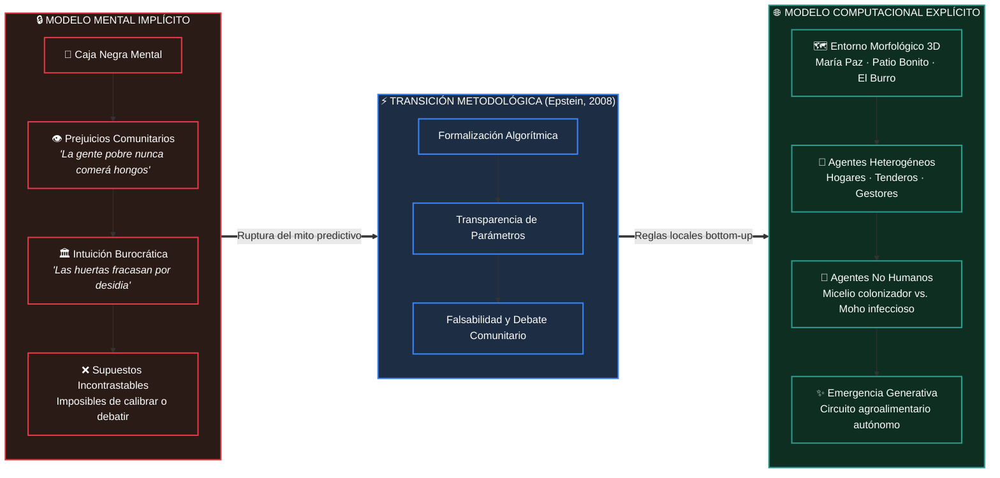
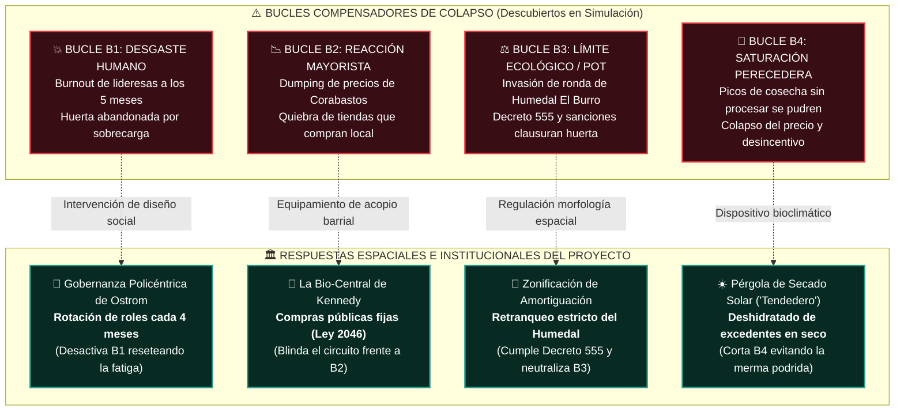

# 🌿 Kennedy 2030: Simulación Urbana Basada en Agentes (ABM)

> **De los Modelos Mentales Implícitos a la Explicación Generativa y la Prevención del Colapso Territorial**  
> *Marco Epistemológico, Dinámica de Sistemas y Diseño Espacial · Localidad de Kennedy, Bogotá D.C.*  
> *Inspirado en el diseño editorial y paisajístico: "form follows fictions &bull; from ego-prediction to eco-generation"*

---

[](#)
[](https://alejagoguti-cpu.github.io/kennedy-2030-infografia/)
[](#)
[-994a36?style=flat-square)](#)
[](#)

---

## 📑 Índice de Diapositivas e Infografías

* [Diapositiva 1: De los Modelos Mentales Implícitos a la Explicación Generativa](#-diapositiva-1-de-los-modelos-mentales-implícitos-a-la-explicación-generativa)
* [Diapositiva 2: Descubrir Bucles de Colapso y Disciplinar la Política Pública Territorial](#-diapositiva-2-descubrir-bucles-de-colapso-y-disciplinar-la-política-pública-territorial)
* [💻 Dashboard Web Interactivo con Modo Sustentador](#-vista-interactiva-en-web)
* [📚 Bibliografía y Referencias Clave](#-bibliografía-de-referencia)

---

# 📊 DIAPOSITIVA 1
## ¿Por qué modelar Kennedy 2030? De los modelos mentales implícitos a la explicación generativa

> *Superando el mito de la predicción: hacer transparentes los supuestos del territorio popular*

### 🧭 Infografía Conceptual: La Transición Metodológica



### 📌 Puntos Clave de la Diapositiva 1

1. **"Usted ya es un modelador" (Epstein, 2008):**
   * Todo líder de la JAC, funcionario distrital o comerciante de Corabastos opera con un modelo mental implícito lleno de supuestos no verificados (*"la gente pobre nunca va a comer hongos"*, *"las huertas comunitarias siempre fracasan por desidia"*).
   * Los modelos implícitos ocultan sus supuestos y son imposibles de calibrar o refutar. Modelar significa **hacer explícitas las reglas** para que la comunidad pueda debatirlas con rigor.

2. **Explicar no es Predecir (Razón 1 de Epstein):**
   * La tectónica de placas explica los terremotos sin predecir el minuto exacto del sismo.
   * Nuestro objetivo **NO** es predecir cuántos kilos exactos de acelga o seta ostra se comerán en octubre de 2030.
   * Nuestro objetivo es una **EXPLICACIÓN GENERATIVA**: demostrar si reglas locales de interacción entre tenderos, huerteros y familias pueden generar macroscópicamente un circuito alimentario estable que no colapse ante las presiones de Corabastos.

3. **Decisiones del Modelo Conectadas al Territorio:**
   * **Entorno:** Topografía y morfología 3D de Kennedy (barrios María Paz, Patio Bonito, Humedal El Burro).
   * **Agentes heterogéneos:** Hogares (aversión cultural al hongo), Tenderos (margen y fiado), Gestores de huerta (curva de energía finita).
   * **Agentes no humanos:** Micelio que coloniza vs. moho que infecta.

> 💬 **CITA DESTACADA AL PIE (D1):**  
> *"La elección no es si construir modelos o no; la elección es si construir modelos explícitos donde los supuestos se expongan con claridad para que otros puedan evaluarlos y replicarlos."*  
> — **Joshua M. Epstein (2008)**

#### 🎙️ Notas de Sustentación (Diapositiva 1):
```markdown
"Profesores: empezamos apoyándonos en Joshua Epstein para desarmar el primer gran prejuicio sobre 
nuestro proyecto: la idea de que modelamos para 'adivinar el futuro'. Epstein demuestra que todos ya 
tenemos un modelo en la cabeza cuando opinamos sobre una política pública, pero suele ser un modelo 
implícito, donde los prejuicios están escondidos. Al modelar Kennedy en un sistema multiagente sobre 
nuestra base 3D, obligamos al proyecto a ser explícito: ¿a qué precio compra el tendero de Patio Bonito?, 
¿cuántas horas de sol necesita el 'tendedero'?, ¿cuándo la tingüa abandona el humedal? No buscamos una 
predicción milagrosa, sino una explicación generativa de cómo la autonomía alimentaria puede emerger 
desde abajo."
```

---

# 📊 DIAPOSITIVA 2
## Descubrir bucles de colapso y disciplinar la política pública territorial

> *Las razones para simular: Sensibilidad, límites compensadores e "ignorancia militante"*

### 🧭 Infografía Sistémica: Los 4 Bucles de Colapso vs. Soluciones Arquitectónicas



---

### 📌 Puntos Clave de la Diapositiva 2

#### 1️⃣ Iluminar Dinámicas Centrales y Límites Ocultos *(Razones 3, 7 y 8 de Epstein)*
En el discurso tradicional, sembrar huertas siempre "funciona" en el papel. En la simulación computacional descubrimos los bucles de retroalimentación negativa que históricamente provocan el colapso de los proyectos comunitarios en Bogotá:

| Bucle | Denominación | Mecánica Causal de la Falla | Límite Crítico Detectado |
| :---: | :--- | :--- | :--- |
| **B1** | **Desgaste / Burnout** | La sobrecarga recae sobre 2 o 3 lideresas comunitarias con energía finita. | Sin rotación institucional, el abandono ocurre a los **5 meses**. |
| **B2** | **Reacción Mayorista** | Corabastos aplica bajas temporales de precio (*dumping*) ante la competencia. | Las tiendas de barrio quiebran si compran a huerta sin protección de margen. |
| **B3** | **Límite Ecológico / POT** | Expansión informal hacia la ronda de protección hídrica de Humedal El Burro. | Sanciones ambientales de la CAR y **Decreto Distrital 555 (POT)** clausuran el proyecto. |
| **B4** | **Saturación Perecedera** | Cosechas pico masivas de setas u hortalizas sin cadena de frío ni procesamiento. | La merma podrida inunda el barrio, hunde los precios y desincentiva el cultivo. |

---

#### 2️⃣ Demostrar Compensaciones y Eficiencias Espaciales *(Razón 10 de Epstein)*
La simulación prueba que la arquitectura no es adorno estético, sino **amortiguador sistémico**:
* ☀️ **Pérgola de secado solar (*"Tendedero"*):** Corta de raíz el bucle **B4** al transformar los excedentes de cosecha en setas secas y hierbas deshidratadas de larga vida útil y alto valor agregado.
* 🏢 **La Bio-Central de Kennedy:** Corta el bucle **B2** al vincular compras institucionales estables (colegios distritales, comedores comunitarios bajo la **Ley 2046 de compras públicas locales**).
* 🔄 **Gobernanza basada en Elinor Ostrom:** Corta el bucle **B1** estableciendo protocolos comunitarios de relevo obligatorio cada **4 meses**.

---

#### 3️⃣ Disciplinar el Diálogo Político y la "Ignorancia Militante" *(Razones 14 y 16 de Epstein)*
* **Militant Ignorance:** Epstein acuña este término para referirse a la rigurosa humildad científica: *un compromiso inquebrantable con el "no lo sabemos hasta que no tengamos evidencia cuantificable"*. No nos escudamos en metas de fantasía (*"Kennedy será 100% autosuficiente"*).
* **Laboratorio de prueba sin víctimas territoriales:** El simulador faculta a las mesas comunitarias de María Paz y Patio Bonito a contrastar escenarios en pantalla (*"¿Qué pasa si la tienda solo compra el 20% local?", "¿Qué ocurre en temporadas de lluvia prolongada?"*) antes de cometer errores millonarios e irreversibles en el suelo real.

---

> 💬 **CITA DESTACADA AL PIE (D2):**  
> *"Todos los modelos son aproximaciones. El mérito de un buen modelo no es ser perfecto, sino ser fructíferamente erróneo: iluminar las incertidumbres críticas y disciplinar el diálogo de opciones."*  
> — **Adaptado de Joshua M. Epstein (2008) y George Box**

---

### 🎙️ Notas de Sustentación (Diapositiva 2 - Guion Oral):

> [!IMPORTANT]
> **Tono del expositor:** Firme, propositivo y con fuerte vinculación entre urbanismo y ciencia de sistemas. Duración objetivo: **90 a 120 segundos**.

```markdown
"En esta segunda diapositiva demostramos por qué el simulador es indispensable antes de construir 
un solo metro cuadrado. 

En los proyectos sociales de Bogotá se comete con frecuencia el error de construir infraestructura 
a ciegas que luego queda vacía o abandonada. Con nuestro modelo identificamos con claridad cuatro 
frenos de colapso: 
1. El agotamiento del voluntariado (B1),
2. La reacción comercial de Corabastos (B2),
3. El límite legal del humedal (B3), y
4. La sobreproducción de perecederos (B4).

El simulador nos permite hacer análisis de sensibilidad y demostrar que equipamientos como 
La Bio-Central y las estaciones de deshidratado no son caprichos formales de diseño, sino 
dispositivos espaciales indispensables para que el sistema barrial no colapse."
```

---

## 💻 Vista Interactiva en Web

El archivo `index.html` cuenta con un switcher de diapositivas interactivo:
1. Navega entre **Diapositiva 1** y **Diapositiva 2**.
2. **Explorador de Bucles B1-B4:** Inspecciona cada bucle de falla y su respuesta arquitectónica.
3. **Simulador de Sensibilidad en Vivo:** Modifica el umbral de compras públicas fijas, la capacidad del tendedero y la rotación comunitaria para ver si el circuito entra en colapso o estabilidad.
4. **Teleprompter Dual:** Guion de sustentación específico para cada diapositiva con contador de tiempo de exposición.

```bash
# Probar localmente en Windows:
start index.html

# O visitar directamente en GitHub Pages:
# https://alejagoguti-cpu.github.io/kennedy-2030-infografia/
```

---

## 📚 Bibliografía de Referencia

* **Epstein, J. M. (2008).** *Why Model?* Journal of Artificial Societies and Social Simulation, 11(4), 12.
* **Box, G. E. P. (1976).** *Science and Statistics.* Journal of the American Statistical Association, 71(356), 791-799.
* **Ostrom, E. (1990).** *Governing the Commons: The Evolution of Institutions for Collective Action.* Cambridge University Press.
* **Alcaldía Mayor de Bogotá.** *Decreto 555 de 2021 (Plan de Ordenamiento Territorial de Bogotá - POT).*
* **Congreso de la República de Colombia.** *Ley 2046 de 2020 (Compras Públicas de Alimentos de la Agricultura Campesina, Familiar y Comunitaria).*
